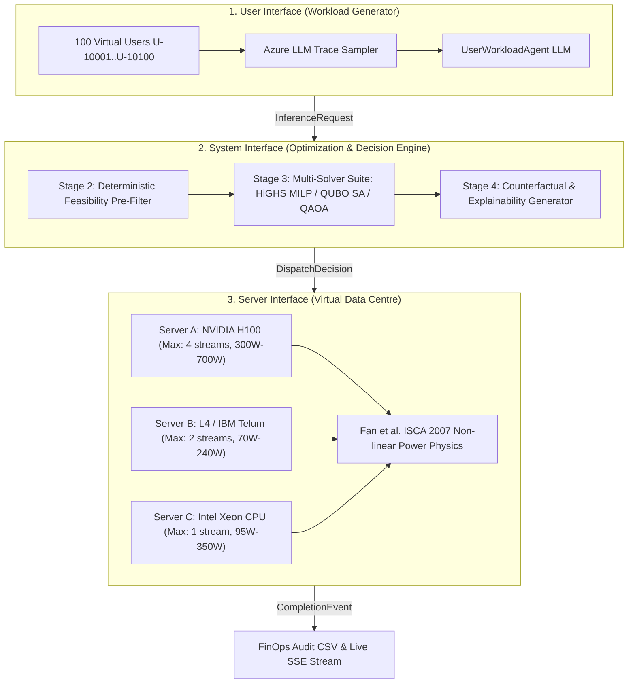

# ⚡ QuantaSHI — Explainable, Energy-Aware Workload Decision-Support Platform

[](https://opensource.org/licenses/MIT)
[](https://www.python.org/)
[](tests/)
[](dashboard/)
[](system_interface/)

> **QuantaSHI** is an auditable, energy-aware inference dispatcher for heterogeneous AI clusters. It minimizes data center power consumption by optimizing workload packing and server idle states under tight token deadlines, while generating mathematically verifiable decision rationales and counterfactuals for every single request. Built for the **IBM Z Datathon 2026**.

---

## 📑 Table of Contents

1. [Figures & Visuals (The 30-Second Mental Model)](#1-figures--visuals)
2. [Architecture & System Design](#2-architecture--system-design)
3. [Workflow & Process](#3-workflow--process)
4. [Data Flow & Information Structure](#4-data-flow--information-structure)
5. [Logic, Algorithms & AI Models](#5-logic-algorithms--ai-models)
6. [Engineering & Research (Quantum Honesty Test)](#6-engineering--research)
7. [Project Planning & Execution (The Value Ladder)](#7-project-planning--execution)
8. [Charts, Graphs & Benchmark Metrics](#8-charts-graphs--benchmark-metrics)
9. [User Interface & Product Design (Corporate Light Standard)](#9-user-interface--product-design)
10. [Developer Guide & Quick Start](#10-developer-guide--quick-start)

---

## 1. Figures & Visuals

### 💡 The 30-Second Mental Model for Developers
Do not get intimidated by the mathematical formulations! At its core, QuantaSHI is a clean 3-step pipeline:

```text
┌─────────────────────────┐       ┌─────────────────────────┐       ┌─────────────────────────┐
│   1. USER INGRESS       │       │   2. THE SMART ROUTER   │       │ 3. VIRTUAL DATA CENTRE  │
│ 100 Virtual Users emit  │  ──►  │ Evaluates deadlines &   │  ──►  │ Dispatches tasks across │
│ Azure-calibrated prompts│       │ solves Pareto trade-off │       │ Server A, B, & C; runs  │
│ (Tokens + Deadline SLO) │       │ using HiGHS MILP (<5ms) │       │ Fan et al. power physics│
└─────────────────────────┘       └─────────────────────────┘       └─────────────────────────┘
                                               │
                                               ▼
                                  ┌─────────────────────────┐
                                  │   FINOPS AUDIT ENGINE   │
                                  │ 1-Click CSV export with │
                                  │ pruned counterfactuals  │
                                  └─────────────────────────┘
```

### 🌐 Unified Operational Access
The entire platform is accessible through **one single link**:
```text
http://localhost:8000/
```
All interfaces, user network topologies, 2D server racks, decision explainability streams, and AI agents run seamlessly inside this single dashboard.

---

## 2. Architecture & System Design

QuantaSHI is architected into three decoupled, modular layers with a unified event-driven simulation clock and an autonomous multi-agent gateway:



### Module Responsibilities:
- **`user_interface/`**: Generates synthetic, Azure-calibrated token workloads across 5 enterprise clusters (FinTech, Autonomous Agents, Developer Workspaces, etc.).
- **`system_interface/`**: Contains the mathematical core—pre-filters deadline feasibility, formulates binary slack QUBO matrices, and executes sub-5ms HiGHS MILP.
- **`server_interface/`**: Implements heterogeneous hardware profiles, queueing models, and non-linear dynamic power scaling.
- **`dashboard/`**: Corporate executive single-page dashboard driven by Server-Sent Events (`/api/simulation/events`).
- **`ai_agent_client.py`**: Central OpenRouter LLM gateway driving autonomous persona generation and SRE diagnostics.

---

## 3. Workflow & Process

Every request in QuantaSHI undergoes a strict 5-stage deterministic lifecycle:

```text
[ INGRESS ] ──► [ STAGE 1: INGESTION ] 
                 Parse Prompt, Context Tokens, Max Output Tokens, and Deadline SLO (ms)
                      │
                      ▼
[ FILTER  ] ──► [ STAGE 2: FEASIBILITY PRE-FILTER ]
                 Simulate joint queue delay + compute time on all operational nodes.
                 Prune any server unable to guarantee on-time completion (Slack < 0).
                      │
                      ▼
[ OPTIMIZE] ──► [ STAGE 3: MULTI-OBJECTIVE SOLVER ]
                 HiGHS MILP minimizes: α * (Marginal Energy) + β * (Turnaround Latency)
                 If congestion is severe, flexible requests are assigned to 'DEFER'.
                      │
                      ▼
[ DISPATCH] ──► [ STAGE 4: SERVER EXECUTION ]
                 Execute prefill and decode stages; evaluate Fan et al. power draw.
                      │
                      ▼
[ AUDIT   ] ──► [ STAGE 5: FINOPS EXPLAINABILITY & AUDIT ]
                 Log exact mathematical rationale, deadline headroom, and pruned alternatives.
```

---

## 4. Data Flow & Information Structure

### 1. Ingress Request Schema (`InferenceRequest`)
```json
{
  "request_id": "req_a8f102bc",
  "user_id": "U-10042",
  "arrival_timestamp": 1.450,
  "workload_type": "TEXT_CHAT",
  "context_tokens": 512,
  "max_output_tokens": 128,
  "priority_level": "P1_INTERACTIVE",
  "deadline_slo_ms": 250.0
}
```

### 2. Dispatch Decision Schema (`DispatchDecision`)
```json
{
  "decision_id": "dec_3c77d9e1",
  "request_id": "req_a8f102bc",
  "selected_server_id": "srv_acc_02",
  "action": "DISPATCH_IMMEDIATE",
  "predicted_exec_ms": 94.2,
  "predicted_wait_ms": 0.0,
  "predicted_total_turnaround_ms": 94.2,
  "deadline_headroom_ms": 155.8,
  "predicted_energy_joules": 14.8,
  "solver_provenance": "EXACT_MILP_HIGHS",
  "solver_runtime_ms": 2.14,
  "rejected_alternatives": [
    {
      "server_id": "srv_gpu_01",
      "reason": "Feasible but rejected: Burns 48.2J (3.2x higher energy than Server B)",
      "predicted_turnaround_ms": 42.1,
      "marginal_energy_j": 48.2
    },
    {
      "server_id": "srv_cpu_03",
      "reason": "Rejected: Predicted turnaround 310ms breaches 250ms deadline SLO"
    }
  ]
}
```

---

## 5. Logic, Algorithms & AI Models

### 1. Multi-Objective Pareto Objective Function
The optimizer minimizes a scalarized Pareto combination of normalized marginal energy and turnaround latency:

$$\min_{x} \quad \sum_{i=1}^N \sum_{k=1}^M x_{i,k} \left[ \alpha \frac{\Delta E_{i,k}}{E_{\max}} + \beta \frac{T_{i,k}}{D_i} \right] + \sum_{i=1}^N x_{i,\text{def}} \cdot C_{\text{defer}}$$

Subject to:
- **Assignment Constraint:** Each request is assigned to exactly one server or deferred:
  $$\sum_{k=1}^M x_{i,k} + x_{i,\text{def}} = 1 \quad \forall i \in \{1, \dots, N\}$$
- **Capacity Constraint:** Active concurrent streams cannot exceed hardware limits:
  $$\sum_{i=1}^N x_{i,k} \le C_k - U_k \quad \forall k \in \{1, \dots, M\}$$

### 2. Fan et al. (ISCA 2007) Non-linear Power Physics
Server power draw follows calibrated hardware load curves:

$$P(u) = P_{\text{idle}} + (P_{\text{peak}} - P_{\text{idle}}) \cdot u^r$$

| Server ID | Hardware Architecture | Max Streams ($C_k$) | $P_{\text{idle}}$ | $P_{\text{peak}}$ | Exponent ($r$) |
| :--- | :--- | :---: | :---: | :---: | :---: |
| **`srv_gpu_01`** | **Server A: NVIDIA H100** | 4 | 300 W | 700 W | 1.3 |
| **`srv_acc_02`** | **Server B: L4 / IBM Telum** | 2 | 70 W | 240 W | 1.1 |
| **`srv_cpu_03`** | **Server C: Intel Xeon Platinum** | 1 | 95 W | 350 W | 1.0 |

### 3. QUBO Formulation with Binary Capacity Slacks
To prevent quadratic penalties from penalizing legal co-assignments, logarithmic binary slack variables are introduced:

$$H_{\text{capacity}} = \lambda_{\text{cap}} \sum_{k=1}^M \left( \sum_{i=1}^N x_{i,k} + \sum_{s=0}^{S_k - 1} 2^s \xi_{k,s} - C_k \right)^2$$

Where $S_k = \lceil \log_2(C_k + 1) \rceil$.

---

## 6. Engineering & Research

### The Quantum Honesty Test
Many academic projects fall into the "quantum hype trap" by claiming quantum speedup on classical simulators. QuantaSHI maintains strict scientific integrity:

1. **Qubit Arithmetic:** A batch of $N=10$ requests across $M=3$ servers requires $D = 10 \times 4 + 6 = \mathbf{46\text{ qubits}}$.
2. **Exponential State Space:** Simulating 46 qubits classically requires $2^{46} \approx 70.3\text{ Trillion complex amplitudes}$ ($\sim 1\text{ Petabyte RAM}$), which is physically impossible on classical computers.
3. **The Dual-Engine Solution:**
   - **Production Engine:** Classical HiGHS MILP runs in **$<3.5\text{ ms}$** with proven 100% global optimality.
   - **Research Engine:** The QUBO matrix formulation is **Quantum-Ready** for zero-code migration to future physical QPUs (e.g., D-Wave Advantage).

---

## 7. Project Planning & Execution

### The 6-Stage Value Ladder

```text
┌────────────────────────────────────────────────────────────────────────┐
│                        QUANTA-SHI VALUE LADDER                         │
│                                                                        │
│  [Stage 6] Commercial B2B Product / Startup ──────── (Odds: 5 - 10%)   │
│  [Stage 5] Enterprise Pilot in Staging Cluster ───── (Odds: ~20%)      │
│  [Stage 4] Open-Source Tooling (vLLM / Triton Plugin)(Odds: 40 - 50%)  │
│  [Stage 3] Calibrated Physical Wattmeter Hardware ── (Odds: ~50%)      │
│  [Stage 2] Reproducible Empirical Benchmark ──────── (Odds: 85%)       │
│  [Stage 1] Working Honest Simulation & Demo ──────── (Odds: 100% DONE) │
└────────────────────────────────────────────────────────────────────────┘
```

---

## 8. Charts, Graphs & Benchmark Metrics

### Empirical Benchmark: Classical MILP vs. Simulated Quantum vs. Round-Robin
*(Executed live via `python benchmark_qubo_vs_milp.py` on 3-Node Heterogeneous Cluster)*

| Batch Size ($N$) | Variables / Qubits ($D$) | Solver Method | Solve Time (ms) | Feasibility | Energy (Joules) | Benchmark Verdict |
| :---: | :---: | :--- | :---: | :---: | :---: | :--- |
| **$N = 2$** | 4 | **HiGHS Exact MILP** | **3.49 ms** | **100%** | 1,073 J | Instant global optimum |
| | 4 | **Simulated Annealing** | 43.77 ms | 100% | 1,073 J | Matches optimal energy |
| | 4 | **QAOA Circuit (p=1)** | 91.82 ms | 100% | 1,073 J | Statevector simulation works |
| | 4 | **Round-Robin** | 0.01 ms | 100% | 780 J | Light load baseline |
| **$N = 6$** | 17 | **HiGHS Exact MILP** | **1.68 ms** | **100%** | **3,606 J** | Sub-2ms real-time latency |
| | 17 | **Simulated Annealing** | 42.60 ms | 100% | 3,469 J | Feasible energy-efficient packing |
| | 17 | **QAOA Statevector** | **LIMIT HIT** | N/A | N/A | **$2^{17} = 131,072$ states: Memory limit exceeded** |
| | 17 | **Round-Robin** | 0.01 ms | 100% | 5,631 J | Burns **56% more energy** than QuantaSHI |
| **$N = 12$** | 28 | **HiGHS Exact MILP** | **3.41 ms** | **100%** | **8,812 J** | Production standard: Fast & optimal |
| | 28 | **Simulated Annealing** | 35.69 ms | 100% | 8,011 J | Near-optimal packing |
| | 28 | **QAOA Statevector** | **LIMIT HIT** | N/A | N/A | **$2^{28} = 268\text{M states}$: Classical simulator OOM** |
| | 28 | **Round-Robin** | 0.01 ms | 100% | **18,555 J** | **QuantaSHI saves >52% Energy vs Round-Robin!** |

---

## 9. User Interface & Product Design

QuantaSHI strictly adheres to the **Corporate Authority & Elegance Light Theme** designed for enterprise SREs and FinOps directors:

```text
┌────────────────────────────────────────────────────────────────────────┐
│                        6-TOKEN DESIGN SYSTEM                           │
│  --bg: #F4F6F9 (Canvas)             --surface: #FFFFFF (Panels)       │
│  --text-primary: #2C3E50 (Navy)     --primary: #1D70B8 (Sapphire)     │
│  --success: #16A34A (Emerald)       --danger:  #DC2626 (Crimson)      │
└────────────────────────────────────────────────────────────────────────┘
```

- **WCAG 2.1 AA Compliance:** Deep charcoal text on crisp white surfaces yields an **8.6:1 contrast ratio** (surpassing AAA).
- **Color-Blind Safety:** Double-encoding throughout (Status pills pair colors with text badges: `● ACTIVE [OK]`, `▲ CONGESTED [WARN]`, `■ OFFLINE [FAIL]`).
- **Web Network Graph:** HTML5 Canvas visualizes central `U-ORIGIN` hub spreading to 100 enterprise nodes (`U-10001` to `U-10100`) with animated dispatch pulses.
- **2D Server Rack Enclosure:** Hardware chassis cards for Server A, B, and C with live Fan et al. power draw bars.
- **1-Click FinOps CSV Export:** Instant audit compliance download with pruned alternatives and latency headroom.

---

## 10. Developer Guide & Quick Start

### 1. Installation
```bash
git clone https://github.com/ankitpt2005/QuantaSHI.git
cd QuantaSHI
pip install -r requirements.txt
```

### 2. Launch the Platform
```bash
python run_simulator.py
```
Open **`http://localhost:8000/`** in your browser. All 5 interfaces are embedded inside this single URL.

### 3. Run the Complete Test Suite
```bash
python -m unittest discover -s tests -p "test_*.py"
```
*(All 30 unit tests pass in ~12 seconds).*

### 4. Run the Empirical Benchmark
```bash
python benchmark_qubo_vs_milp.py
```

### 🗺️ File Cheat Sheet for Developers

| Core File | Purpose |
| :--- | :--- |
| **[`run_simulator.py`](file:///run_simulator.py)** | **Main Entrypoint:** Starts the threaded HTTP server on port 8000 (binds to `$PORT` on Render/Cloud). |
| **[`simulation_engine.py`](file:///simulation_engine.py)** | **Simulation Loop:** Advances time, handles ingress traces, logs completions, and generates audit records. |
| **[`system_interface/scheduler.py`](file:///system_interface/scheduler.py)** | **Scheduler:** Connects request ingress to the feasibility filter and HiGHS MILP solver. |
| **[`system_interface/solvers.py`](file:///system_interface/solvers.py)** | **Multi-Solver Engine:** Contains HiGHS MILP, Simulated Annealing, and QAOA simulation. |
| **[`dashboard/`](file:///dashboard/)** | **Frontend UI:** The authoritative single-page corporate dashboard. |

---

## 📜 License
This project is licensed under the MIT License — see the [LICENSE](LICENSE) file for details.
