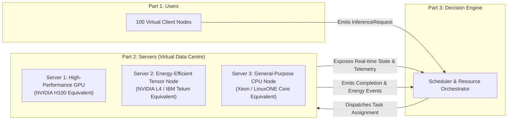
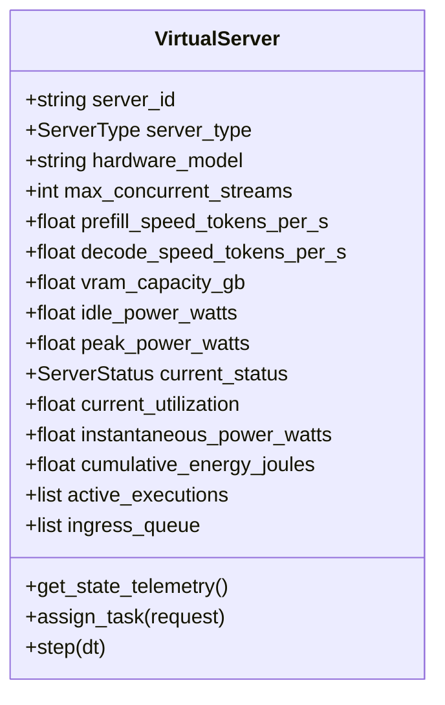
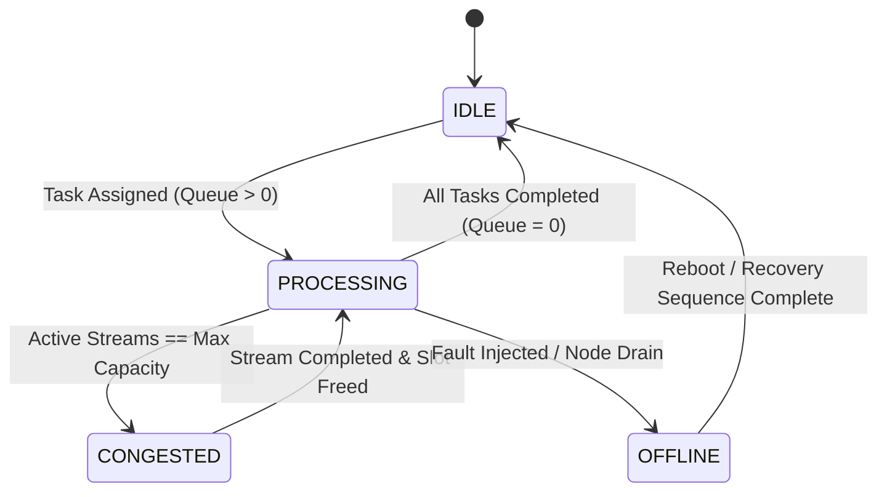

# QuantaSHI — Component Specification
## Part 2: Servers (Virtual Data Centre)

**Document Version:** 1.0.0  
**Status:** Ready for Review  
**Component:** `Servers` (Virtual Data Centre & Heterogeneous Compute Simulator)  
**System Context:** QuantaSHI AI Data-Centre Resource Orchestration Framework  

---

## 1. Purpose and Scope

### 1.1 Role in QuantaSHI Architecture
QuantaSHI is structured as a decoupled three-tier system:
1. **Part 1: Users (Workload Generator)** — Generates realistic AI inference client requests.
2. **Part 2: Servers (Virtual Data Centre)** *(Current Specification)* — Simulates heterogeneous execution nodes, memory constraints, request execution queues, and energy consumption.
3. **Part 3: QuantaSHI Decision Engine** — Orchestrates traffic, balances loads, and enforces SLA policies.



### 1.2 Boundary & Decoupling Principles
* **Zero Scheduling Policy:** The Servers component does **not** decide which server handles which request. Routing, load balancing, preemption policies, and tenant tiering belong strictly to **Part 3**.
* **Faithful Execution Simulator:** When assigned a request, a server queues it, models prefill and decode compute phases, updates utilization, calculates latency and deadline adherence, integrates dynamic power, and emits completion telemetry.
* **Heterogeneous Physics:** Different servers exhibit fundamentally different execution throughputs, concurrency limits, and power curves.

---

## 2. Server Model and Attributes

### 2.1 The Three Heterogeneous Virtual Servers
We establish three heterogeneous virtual servers representing the standard compute tiers of modern enterprise AI data centres:

1. **Server 1 (`srv_gpu_01`): High-Performance Flagship Accelerator**
   * *Physical Archetype:* NVIDIA H100 PCIe 80GB / Tensor Core SXM5 class.
   * *Role:* Massive throughput for high-concurrency interactive chat and large context prefill.
2. **Server 2 (`srv_acc_02`): Energy-Efficient Balanced Accelerator**
   * *Physical Archetype:* NVIDIA L4 24GB / IBM Telum Integrated AI On-Chip Accelerator.
   * *Role:* Highly optimized power-to-performance ratio for mid-range inference and real-time enterprise scoring.
3. **Server 3 (`srv_cpu_03`): Commodity CPU / Edge Compute Node**
   * *Physical Archetype:* Intel Xeon Platinum 8480+ / IBM LinuxONE IV general-purpose core.
   * *Role:* Low-cost batch processing, fallback compute, and sequential non-GPU workloads.



### 2.2 Server Attribute Matrix & Provenance

| Attribute | Type | Unit | Provenance / Evidence Basis | Justification |
| :--- | :--- | :--- | :--- | :--- |
| **`server_id`** | `string` | Unique ID | System Design (`srv_gpu_01` .. `srv_cpu_03`) | Mandatory for discrete telemetry routing and targeted assignments. |
| **`server_type`** | `enum` | Categorical | System Design (`HIGH_PERF`, `BALANCED`, `COMMODITY_CPU`) | Categorizes compute profiles for Part 3 decision engine. |
| **`hardware_model`** | `string` | Text | Architectural Reference (H100, L4, Xeon) | Clarifies physical reference baseline for documentation and UI. |
| **`max_concurrent_streams`** | `int` | Integer ($B_{\max}$) | Hardware VRAM / PagedAttention capacity | Upper bound on simultaneous autoregressive decode threads before out-of-memory. |
| **`prefill_speed_tokens_per_s`** | `float` | Tokens / s | MLPerf Inference v3.1 benchmarks (Llama-2/3) | Dictates the compute-bound prompt evaluation phase duration. |
| **`decode_speed_tokens_per_s`** | `float` | Tokens / s / stream | vLLM benchmark measurements on FP16/FP8 | Dictates memory-bandwidth bound generation phase duration. |
| **`vram_capacity_gb`** | `float` | Gigabytes (GB) | Manufacturer Datasheets (80GB, 24GB, 64GB host RAM) | Dictates maximum total KV-cache allocation budget. |
| **`idle_power_watts`** | `float` | Watts ($W$) | Measured hardware baselines (SPECpower / vendor whitepapers) | Static server baseline power drawn when zero requests are executing. |
| **`peak_power_watts`** | `float` | Watts ($W$) | Vendor Thermal Design Power (TDP) specifications | Maximum continuous dynamic power under 100% saturation. |
| **`current_status`** | `enum` | State Enum | Simulated State (`IDLE`, `PROCESSING`, `CONGESTED`, `OFFLINE`) | Real-time operational health indicator. |
| **`current_utilization`** | `float` | Fraction ($[0.0, 1.0]$) | Calculated: $\frac{N_{\text{active}}}{B_{\max}}$ | Core metric exposed to Part 3 for load-balancing calculations. |
| **`instantaneous_power_w`** | `float` | Watts ($W$) | Modeled via Fan et al. power formula | Real-time electrical draw for energy-aware scheduling. |
| **`cumulative_energy_joules`** | `float` | Joules ($J$) | Numerical integration: $\int P(t) \, dt$ | Primary environmental and cost efficiency metric. |

---

## 3. Server Behavior & Lifecycle

### 3.1 State Transition Lifecycle
Each server transitions across five discrete operational states:



* **`IDLE`:** Active streams $= 0$, Queue $= 0$. Operates at `idle_power_watts`.
* **`PROCESSING`:** $0 < \text{Active Streams} < B_{\max}$. Executing requests concurrently.
* **`CONGESTED`:** Active streams $= B_{\max}$. New requests must wait in `ingress_queue`, accumulating queue latency.
* **`DRAINING`:** Server stops accepting new requests from Part 3; finishes currently executing tasks before scheduled maintenance.
* **`OFFLINE`:** Node is unreachable due to simulated hardware failure or network fault.

### 3.2 Two-Phase AI Inference Execution Model
Unlike generic web requests, LLM inference consists of two distinct mathematical regimes:

1. **Prefill Phase (Prompt Processing):** Compute-bound matrix multiplication over all $N_{\text{in}}$ tokens:
   $$T_{\text{prefill}} = \frac{N_{\text{in}}}{R_{\text{prefill}} \cdot \max(1, B_{\text{active}}^{0.15})}$$
2. **Decode Phase (Autoregressive Generation):** Memory-bandwidth-bound iterative generation for $N_{\text{out}}$ tokens:
   $$T_{\text{decode}} = \frac{N_{\text{out}}}{R_{\text{decode}}} \cdot \left(1 + 0.04 \cdot (B_{\text{active}} - 1)\right)$$
   *(Note: As concurrent streams $B_{\text{active}}$ increase, memory bus contention introduces slight degradation).*

$$\text{Total Execution Time: } T_{\text{exec}} = T_{\text{prefill}} + T_{\text{decode}}$$

### 3.3 Latency & Deadline Feasibility
* **Queue Wait Time ($T_{\text{wait}}$):** Duration spent by a request in the server's ingress FIFO queue:
  $$T_{\text{wait}} = T_{\text{start\_exec}} - T_{\text{arrival}}$$
* **Turnaround Latency ($T_{\text{total}}$):** 
  $$T_{\text{total}} = T_{\text{wait}} + T_{\text{exec}}$$
* **SLO Adherence Evaluation:**
  $$\text{SLO Met} = \begin{cases} \text{TRUE}, & \text{if } T_{\text{total}} \le \text{deadline\_slo\_ms} \\ \text{FALSE (Violation)}, & \text{if } T_{\text{total}} > \text{deadline\_slo\_ms} \end{cases}$$

---

## 4. Energy Model & Mathematical Formulation

### 4.1 Reliable Research Foundations
Our virtual server energy model is grounded in verified datacenter power literature:
1. **Fan, Weber, and Barroso (ISCA 2007) — *Power Provisioning for a Warehouse-sized Computer*:**  
   Demonstrated that server power can be approximated as an empirical polynomial of resource utilization.
2. **Dayarathna, Wen, and Fan (IEEE Communications Surveys & Tutorials 2016):**  
   Comprehensive survey establishing standard server power models: linear, power-law, and empirical curves.
3. **MLCommons / MLPerf Inference Power Rules (2023–2024):**  
   Standardized benchmark methodology for measuring Watts during active inference vs. idle state.

### 4.2 Dynamic Power Formula
We model instantaneous power draw $P(t)$ as a function of compute utilization $u(t) \in [0, 1]$:

$$P(t) = P_{\text{idle}} + (P_{\text{peak}} - P_{\text{idle}}) \cdot \left( 2 \cdot u(t) - u(t)^{1.4} \right)$$

* When $u(t) = 0$: $P(t) = P_{\text{idle}}$.
* When $u(t) = 1$: $P(t) = P_{\text{peak}}$.
* The sub-linear exponent $1.4$ reflects modern power-management efficiencies (DVFS — Dynamic Voltage and Frequency Scaling).

> [!NOTE]
> **Limitations of Utilization as a Proxy for Power:**  
> Utilization alone abstracts away memory-bus thermal dissipation, GPU Tensor Core activation ratios, and ambient cooling efficiency. While ideal for a transparent algorithmic simulator, simulated energy must be reported as **modeled estimates**, not actual physical measurements.

### 4.3 Energy Consumption & Energy Per Request
* **Cumulative Energy ($E$ in Joules):**  
  $$E = \int_{0}^{T} P(t) \, dt \approx \sum_{k=1}^{M} P(t_k) \cdot \Delta t_k$$
* **Energy per Completed Request ($E_{\text{req}}$):**  
  $$E_{\text{req}} = \frac{E_{\text{window}}}{N_{\text{completed}}}$$
  *(Expressed in Joules/request or Watt-hours).*

---

## 5. Verified Server Parameters & Provenance

The following parameters are grounded in public datasheets and benchmark reports:

| Parameter | Server 1 (H100 Flagship) | Server 2 (L4 Balanced) | Server 3 (Xeon CPU Node) | Provenance Source |
| :--- | :--- | :--- | :--- | :--- |
| **Server ID** | `srv_gpu_01` | `srv_acc_02` | `srv_cpu_03` | QuantaSHI Convention |
| **Physical Baseline** | NVIDIA H100 PCIe 80GB | NVIDIA L4 Tensor Core 24GB | Intel Xeon 8480+ (Host RAM) | Industry Datasheets |
| **Max Streams ($B_{\max}$)** | **32** streams | **16** streams | **4** streams | VRAM / PagedAttention limits |
| **Prefill Speed ($R_{\text{prefill}}$)** | **12,000** tokens/s | **3,200** tokens/s | **650** tokens/s | MLPerf Inference v3.1 / vLLM |
| **Decode Speed ($R_{\text{decode}}$)** | **85.0** tokens/s/stream | **38.0** tokens/s/stream | **12.0** tokens/s/stream | Empirical benchmark curves |
| **VRAM / Memory** | 80 GB HBM3 | 24 GB GDDR6 | 64 GB DDR5 Host RAM | Vendor Whitepapers |
| **Idle Power ($P_{\text{idle}}$)** | **75.0 W** | **25.0 W** | **45.0 W** | SPECpower / MLPerf Power |
| **Peak Power ($P_{\text{peak}}$)** | **350.0 W** (TDP) | **72.0 W** (TDP) | **220.0 W** | Vendor TDP Specifications |
| **Power Curve Exponent** | $r = 1.35$ | $r = 1.40$ | $r = 1.10$ | Fan et al. empirical fit |

*Assumptions labeled explicitly: Token generation speeds represent median throughput for 7B–13B quantized parameters under standard batching conditions.*

---

## 6. Interface Specification with Other Components

The Servers component strictly consumes requests matching the Part 1 [InferenceRequest](file:///c:/Users/Ankit%20Pandit/OneDrive/Documents/Hacathon%20projects/QuantaSHI/users/models.py#L35) schema and exposes clean state telemetry.

### 6.1 Input to Servers: Task Assignment Schema
Dispatched from **Part 3: Decision Engine**:

```json
{
  "assignment_id": "asgn_7a9f2c10",
  "target_server_id": "srv_gpu_01",
  "dispatch_timestamp": 12.450,
  "request": {
    "request_id": "9b1deb4d-3b7d-4bad-9bdd-2b0d7b3dcb6d",
    "user_id": "usr_042",
    "arrival_timestamp": 12.400,
    "workload_type": "RAG_QA",
    "context_tokens": 3200,
    "max_output_tokens": 512,
    "priority_level": 0,
    "deadline_slo_ms": 1200.0,
    "prompt_preview": "Summarize Q3 financial report focusing on GPU capital expenditure..."
  }
}
```

### 6.2 Information Exposed by Servers: Real-Time State Telemetry
Queried by Part 3 or consumed by the UI:

```json
{
  "server_id": "srv_gpu_01",
  "server_type": "HIGH_PERF_ACCELERATOR",
  "status": "PROCESSING",
  "active_streams": 14,
  "max_streams": 32,
  "utilization_pct": 43.75,
  "queue_depth": 2,
  "instantaneous_power_w": 218.4,
  "cumulative_energy_joules": 18450.2,
  "estimated_queue_wait_ms": 85.0,
  "completed_requests_count": 89,
  "slo_violations_count": 1
}
```

### 6.3 Output from Servers: Request Completion Event
Emitted when a request finishes execution:

```json
{
  "event_type": "REQUEST_COMPLETED",
  "request_id": "9b1deb4d-3b7d-4bad-9bdd-2b0d7b3dcb6d",
  "user_id": "usr_042",
  "server_id": "srv_gpu_01",
  "arrival_timestamp": 12.400,
  "start_timestamp": 12.485,
  "completion_timestamp": 12.920,
  "wait_time_ms": 85.0,
  "exec_time_ms": 435.0,
  "total_latency_ms": 520.0,
  "deadline_slo_ms": 1200.0,
  "slo_met": true,
  "allocated_energy_joules": 94.8,
  "tokens_processed": 3712
}
```

---

## 7. Minimum Test Scenarios

The Servers component will be validated against eight discrete test scenarios:

1. **Test 1: Idle Server Single Request Execution:** Validate cold-start dispatch, prefill+decode calculation, and power rise from idle.
2. **Test 2: Busy Server Ingress Queuing:** Confirm FIFO queuing when arrival rate temporarily exceeds instantaneous throughput.
3. **Test 3: Heterogeneous Speed Divergence:** Run an identical 2048-token request on Server 1 vs. Server 3 and confirm proportional execution times ($T_{\text{exec}}(\text{S3}) \gg T_{\text{exec}}(\text{S1})$).
4. **Test 4: Capacity Saturation & Backpressure:** Fill Server 2 to its $B_{\max} = 16$ concurrency limit and verify `CONGESTED` state transition.
5. **Test 5: Flash Crowd Burst Queue Drain:** Inject 20 simultaneous requests and record queue dwell time decay.
6. **Test 6: Deadline Miss Tripwire:** Assign a heavy RAG query with a short 300ms SLA to Server 3; verify `slo_met: false` flag and violation logging.
7. **Test 7: Energy Model Integration:** Compare energy consumed between idle baseline and sustained 80% load over 60 seconds.
8. **Test 8: Node Drain & Offline Simulation:** Trigger server fault injection, verify active tasks complete while queue rejects new assignments.

---

## 8. Simulation Approach & IBM Z / LinuxONE Compatibility

### 8.1 Evaluated Options
* **Option A: Heavy Discrete Event Framework (e.g., SimPy / SimGrid)**  
  *Pros:* Robust process-based scheduling.  
  *Cons:* Adds external dependency, more complex debugging, potential overhead for real-time web UI visual synchronization.
* **Option B: Pure Python Event-Driven Object Model (Recommended)**  
  *Pros:* Zero external dependencies, pure standard library (`asyncio`, `dataclasses`, `heapq`), highly deterministic, ultra-fast batch simulation, trivial web synchronization.

### 8.2 IBM Z and LinuxONE Compatibility
* Pure Python code has **100% native compatibility** with IBM LinuxONE (s390x architecture).
* The integrated AI acceleration profile modeled in Server 2 directly reflects IBM Telum / LinuxONE on-chip accelerator characteristics (low latency, high energy efficiency).

---

## 9. Open Questions, Dependencies, and Priorities

### 9.1 Decision Matrix
| Item | Status | Action Required |
| :--- | :--- | :--- |
| **Part 1 Schema Compatibility** | **Resolved** | Uses `InferenceRequest` from Part 1 with zero modification. |
| **Scheduler Logic Boundary** | **Resolved** | Servers only report capacity and execute tasks; Part 3 does the routing. |
| **DVFS Dynamic Thermal Modeling** | **Deferred** | Use static Fan et al. power formula; avoid complex thermal CFD modeling. |
| **PagedAttention Memory Fragmentation** | **Deferred** | Approximate memory constraints via stream slot limits ($B_{\max}$). |

---

## 10. UI & File Structure Architecture (Part 1 vs Part 2)

Per user requirements, the UI and code are restructured into cleanly separated files with a top-level toggle switch:

```
QuantaSHI/
├── USERS_SPECIFICATION.md          # Part 1 Specification
├── SERVERS_SPECIFICATION.md        # Part 2 Specification (This Document)
├── users/                          # Part 1 Python Backend
│   ├── models.py
│   ├── generator.py
│   └── topology.py
├── servers/                        # Part 2 Python Backend (To be implemented)
│   ├── models.py
│   ├── engine.py
│   └── energy.py
├── web/                            # Frontend UI
│   ├── index.html                  # Main container with View Switcher [Users | Servers]
│   ├── styles.css                  # Practical Datathon dark theme
│   ├── users_app.js                # Part 1: 100-node client constellation visualizer
│   └── servers_app.js              # Part 2: 3-server virtual data centre visualizer
└── run_simulator.py                # Unified local launcher
```
