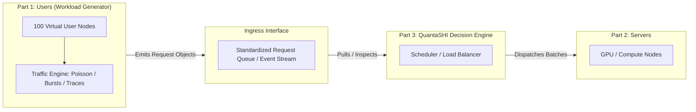
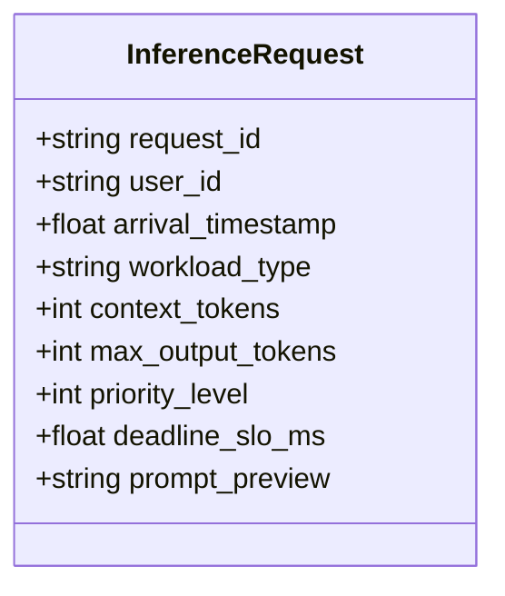

# QuantaSHI - Component Specification
## Part 1: Users (Workload Generator)

**Document Version:** 1.0.0  
**Status:** Ready for Review  
**Component:** `Users` (Workload Generator & Traffic Simulator)  
**System Context:** QuantaSHI AI Data-Centre Resource Orchestration Framework  

---

## 1. Purpose and Scope

### 1.1 Role in QuantaSHI
QuantaSHI is designed as a three-component architecture:
1. **Part 1: Users (Workload Generator)** *(Current Scope)*
2. **Part 2: Servers (Inference Compute Cluster Simulator)**
3. **Part 3: QuantaSHI Decision Engine (Intelligent Scheduler & Load Balancer)**

The **Users** component functions as an autonomous, configurable workload generator. Its sole responsibility is to simulate realistic incoming AI inference demands from client applications and human users, presenting these requests to the system without coupling itself to server-side execution dynamics or scheduling logic.



### 1.2 Boundary & Decoupling Principles
- **Open-Loop vs. Closed-Loop:** The generator supports both open-loop trace replay (arrival times are predetermined regardless of system backpressure) and closed-loop interactive mode (virtual users pause and "think" once a request is fulfilled before generating the next).
- **Zero Server Contamination:** The Users component does **not** simulate GPU memory usage, execution times, or scheduling policies. It only outputs what the client *requests* and *expects* (SLO).
- **Interactive Visual Readiness:** The component tracks discrete per-user states (`IDLE`, `REQUESTING`, `WAITING`) and maintains a network topology graph to allow real-time visual inspection of individual user nodes in the web UI.

---

## 2. Virtual User & Request Model

### 2.1 What a Virtual User Represents
In modern AI cloud datacenters, an inference client is rarely an isolated single user sitting at a prompt; requests originate from diverse client tiers:
- **Interactive End-Users:** Individual human users querying conversational agents (e.g., ChatGPT, Copilot) with human reading/thinking latency between queries (10s–60s).
- **Automated Enterprise Microservices:** Backend services (e.g., semantic search, automated code review bots, RAG pipelines) executing high-frequency, programmatic queries.
- **Batch Processing Tenants:** Non-urgent background summarization, embedding generation, or document ingestion jobs.

For our baseline of **100 Virtual Users ($U_1 \dots U_{100}$)**:
- Each user represents a distinct logical client entity with an assigned **Tenant Profile** (e.g., Free Tier, Enterprise Premium, Automated Service) and an assigned node in the network topology.
- Users are assigned a **Service Level Agreement (SLA) Tier**, which determines the default priority class and latency expectations of their generated requests.

### 2.2 Traffic Behavior: Continuous, Periodic, or Bursts?
Real-world datacenter traffic exhibits a mixture of all three regimes rather than a single uniform mode:

| Pattern | Description | Application in AI Inference | Model Implementation |
| :--- | :--- | :--- | :--- |
| **Bursty (Primary)** | Clusters of requests arriving within milliseconds, followed by quiet periods | Multi-turn user conversations, collaborative tools, or flash crowds reacting to breaking events. | Markov-Modulated Poisson Process (MMPP) or Pareto distributed inter-arrival times. |
| **Periodic (Secondary)** | Requests arriving at regular scheduled intervals | Recurring cron jobs, automated hourly reporting, periodic data indexing. | Deterministic interval generation ($\Delta t = \text{constant} \pm \epsilon$). |
| **Continuous / Poisson (Baseline)** | Random, independent request arrivals with stationary mean | Steady aggregate baseline of thousands of distributed end-users. | Memoryless Poisson process: Inter-arrival times $\tau \sim \text{Exp}(\lambda)$. |

**Design Choice:** The generator implements a **Hybrid Multi-Mode Engine**:
1. Default baseline runs a stationary Poisson arrival process across users with individual "think time" distributions.
2. Configurable burst triggers can inject correlated flash-crowd bursts (e.g., 20–40 users simultaneously firing requests).
3. A designated subset of users (e.g., 10%) operates in periodic batch mode.

---

## 3. Request Attributes & Justification

To prevent unnecessary complexity while ensuring the QuantaSHI Decision Engine has all necessary data to schedule efficiently, we define a lean, strictly justified attribute schema.



### 3.1 Attribute Definitions & Justification Matrix

| Field | Type | Unit / Enum | Justification (Why it is strictly needed) |
| :--- | :--- | :--- | :--- |
| **`request_id`** | String (UUID) | Unique ID | Mandatory for end-to-end telemetry, logging, and matching completed tokens/responses back to the source client. |
| **`user_id`** | String / Int | `usr_001` .. `usr_100` | Mandatory for: (1) Per-user rate-limiting and fairness in QuantaSHI; (2) Network graph visualizer to map live requests to specific nodes when clicked. |
| **`arrival_timestamp`** | Float | Simulation Seconds / Unix ms | Mandatory for queue latency measurement, First-In-First-Out (FIFO) ordering, and calculating Wait Time = $T_{\text{start}} - T_{\text{arrival}}$. |
| **`workload_type`** | String / Enum | `TEXT_CHAT`, `CODE_GEN`, `RAG_QA`, `SUMMARIZATION` | Essential because LLM inference FLOPs and KV-cache characteristics vary fundamentally by task type (e.g., RAG is prefill-heavy; Code Gen is decode-heavy). |
| **`context_tokens`** | Integer | Tokens ($N_{\text{in}}$) | **Core compute metric for Prefill phase.** Dictates initial GPU memory allocation (KV cache) and prefill matrix multiplication overhead: $\mathcal{O}(N_{\text{in}}^2)$ attention computation. |
| **`max_output_tokens`** | Integer | Tokens ($N_{\text{out}}$) | **Core compute metric for Decode phase.** Dictates the number of autoregressive token iterations and memory block reservations in PagedAttention algorithms. |
| **`priority_level`** | Integer / Enum | `P0_CRITICAL` (0), `P1_INTERACTIVE` (1), `P2_BATCH` (2) | Required for QuantaSHI to make non-trivial scheduling decisions (e.g., preempting batch requests to serve interactive chat). Without priority, any scheduler reduces to simple FIFO. |
| **`deadline_slo_ms`** | Float | Milliseconds ($D$) | Defines the maximum acceptable turnaround time before a Service Level Objective (SLO) violation occurs. Enables Earliest Deadline First (EDF) and slack-time scheduling in QuantaSHI. |
| **`prompt_preview`** | String | Text Snippet ($\le 120$ chars) | Optional for pure math simulation, but **mandatory for interactive UI**: allows an operator clicking a node in the web visualizer to inspect the human-readable query. |

### 3.2 Attributes Explicitly Excluded
- **Target GPU / Node ID:** Excluded. Clients must never dictate datacenter node allocation; that is the internal responsibility of QuantaSHI.
- **Execution Duration / Latency:** Excluded. Execution time cannot be known at request generation time; it is a dependent output produced by the Server simulation.
- **Full Model Tensor Weights:** Excluded. Lightweight metadata passing is standard for inference orchestrators.

---

## 4. Data Requirements: Real-World vs. Synthetic

To maintain scientific integrity, we strictly separate verified public empirical datasets from synthetic fields that must be modeled.

### 4.1 Verified Public Datasets (Direct Sources)

1. **Microsoft Azure LLM Inference Traces (2024)**
   - **Repository:** [Azure/AzurePublicDataset on GitHub](https://github.com/Azure/AzurePublicDataset)
   - **Trace Files:** `AzureLLMInferenceTrace_code.csv`, `AzureLLMInferenceTrace_conv.csv`
   - **Origin:** Real production traces from Microsoft Azure AI services (published alongside the HPCA 2024 *DynamoLLM* paper).
   - **Verified Fields Available:**
     - `TIMESTAMP`: Real arrival epoch/invocation time.
     - `ContextTokens`: Real prompt context length distribution.
     - `GeneratedTokens`: Real generated response length distribution.
   - **Limitation:** Raw prompt text is omitted for GDPR/privacy compliance; user IDs are stripped and cannot be mapped to individual virtual users without synthetic partitioning.

2. **AllenAI WildChat Dataset**
   - **Repository:** [allenai/WildChat on Hugging Face](https://huggingface.co/datasets/allenai/WildChat-1M)
   - **Origin:** Real user-ChatGPT multi-turn interactions (over 1M interactions) logged via public Hugging Face spaces.
   - **Verified Fields Available:** Real conversation text, multi-turn dialogue structure, hashed user IPs/sessions, model names (`gpt-3.5-turbo`, `gpt-4`), and UTC timestamps.
   - **Utility:** Provides realistic, non-synthetic human prompts for UI inspection and token length validation.

3. **MLPerf Inference Benchmark Suite**
   - **Repository:** [mlcommons/inference on GitHub](https://github.com/mlcommons/inference)
   - **Origin:** Standardized industry consortium benchmark (MLCommons) for datacenter inference.
   - **Utility:** Provides standard load generation profiles (LoadGen), target QPS benchmarks, and standardized task splits (Llama 2/3, BERT, Whisper).

### 4.2 Data Origin Breakdown: Ground-Truth vs. Generated

| Attribute | Source Type | Acquisition Strategy |
| :--- | :--- | :--- |
| `arrival_timestamp` | **Hybrid** | Option A: Replay exact intervals from Azure LLM traces.<br>Option B: Parameterized Poisson / Pareto generator calibrated to empirical Azure trace arrival rates. |
| `context_tokens` | **Real Data** | Sampled directly from empirical cumulative distribution functions (CDF) of Azure LLM trace `ContextTokens`. |
| `max_output_tokens` | **Real Data** | Sampled directly from empirical CDF of Azure LLM trace `GeneratedTokens`. |
| `prompt_preview` | **Real Data** | Sampled from anonymized prompt strings in the `allenai/WildChat-1M` corpus. |
| `user_id` (1..100) | **Synthetic** | Real traces omit user privacy IDs. We assign incoming requests to the 100 virtual users using a Dirichlet/multinomial distribution (modeling active vs. idle users). |
| `priority_level` | **Synthetic** | Cloud providers do not publish tenant pricing tiers. Modeled synthetically based on realistic enterprise ratios: $15\%$ P0, $60\%$ P1, $25\%$ P2. |
| `deadline_slo_ms` | **Synthetic** | Computed via standard latency budget functions: $\text{SLO} = \text{TTFT}_{\text{target}} + (N_{\text{out}} \times \text{TBT}_{\text{target}})$, where Time-to-First-Token $\approx 200\text{ms}$ and Time-Between-Tokens $\approx 25\text{ms}$. |

---

## 5. Workload Scenarios

We define four test scenarios to rigorously evaluate the QuantaSHI Decision Engine and Server components. All numerical rates are baseline assumptions subject to calibration during execution.

```mermaid
gantt
    title Workload Test Scenarios
    dateFormat X
    axisFormat %s s
    section S1: Normal
    Homogeneous Poisson Traffic (15-20 req/s) :0, 60
    section S2: Flash Burst
    Baseline Traffic :0, 20
    Flash Surge (5x Spike, 100 req/s) :20, 40
    Recovery Baseline :40, 60
    section S3: Bimodal
    Mixed Short Chat & Huge RAG Contexts :0, 60
    section S4: SLA Stress
    130% Over-subscription & Contention :0, 60
```



### 5.1 Scenario 1: Steady-State Baseline (Normal Traffic)
- **Objective:** Establish the baseline throughput, queue dwell time, and latency under non-congested conditions.
- **Traffic Specification:**
  - Active Users: All 100 users active with stochastic think times ($t_{\text{think}} \sim \text{LogNormal}(\mu=10s, \sigma=0.5)$).
  - Aggregate Rate: $\lambda \approx 15 \text{ to } 20 \text{ req/s}$.
  - Token Distribution: Normal distribution centered around median chat workloads ($N_{\text{in}} \in [128, 512]$, $N_{\text{out}} \in [64, 256]$).
  - Priority Mix: Standard distribution (15% P0, 60% P1, 25% P2).
- **Target Test Outcome:** Verifies stability; expected zero dropped requests and $\ge 99\%$ SLO adherence.

### 5.2 Scenario 2: Sudden Traffic Surge / Flash Crowd (Burst Testing)
- **Objective:** Test QuantaSHI admission control, queue backpressure, and preemptive priority scheduling under sudden overload.
- **Traffic Specification:**
  - $t \in [0s, 20s]$: Normal baseline (15 req/s).
  - $t \in [20s, 35s]$: **Flash Surge.** 50 virtual users simultaneously trigger requests within 500ms, driving arrival rate to $\lambda \ge 100 \text{ req/s}$ ($5\times$ surge).
  - $t \in [35s, 60s]$: Return to baseline rate.
- **Target Test Outcome:** Validates that P0 critical requests remain within latency SLOs by preempting or deferring P2 batch requests; verifies queue recovery time.

### 5.3 Scenario 3: Workload Heterogeneity (Bimodal Asymmetric Demand)
- **Objective:** Evaluate memory fragmentation and mitigation of Head-of-Line (HoL) blocking when short chat requests collide with huge context windows.
- **Traffic Specification:**
  - **Category A (Short Chat, 80% volume):** $N_{\text{in}} \in [64, 256]$, $N_{\text{out}} \in [32, 128]$, Strict SLO ($< 800\text{ms}$).
  - **Category B (Elephant RAG/Document Analysis, 20% volume):** $N_{\text{in}} \in [4000, 16000]$, $N_{\text{out}} \in [512, 2048]$, Relaxed SLO ($< 15000\text{ms}$).
- **Target Test Outcome:** Validates whether QuantaSHI can prevent long-context prefill tasks from starving latency-sensitive interactive requests.

### 5.4 Scenario 4: Over-subscription & SLA Contention (Stress Test)
- **Objective:** Verify graceful degradation and fairness enforcement when sustained demand exceeds 120% of theoretical cluster capacity.
- **Traffic Specification:** Continuous high arrival rate ($\lambda = 50\text{ req/s}$) sustained for the entire simulation duration.
- **Target Test Outcome:** QuantaSHI must drop or shed load gracefully while protecting P0 SLAs and maintaining fair-share allocation across tenant user IDs.

---

## 6. Output Format and Interface Specification

The Users component communicates with downstream components via a clean, decoupled interface.

### 6.1 JSON Request Payload Schema
Every request emitted by the Workload Generator conforms strictly to the following schema:

```json
{
  "$schema": "https://json-schema.org/draft/2020-12/schema",
  "title": "QuantaSHI_InferenceRequest",
  "type": "object",
  "properties": {
    "request_id": {
      "type": "string",
      "format": "uuid",
      "description": "Unique identifier for request tracing"
    },
    "user_id": {
      "type": "string",
      "pattern": "^usr_[0-9]{3}$",
      "description": "Identifier of originating virtual user (usr_001 to usr_100)"
    },
    "arrival_timestamp": {
      "type": "number",
      "description": "Simulation time in seconds from run start"
    },
    "workload_type": {
      "type": "string",
      "enum": ["TEXT_CHAT", "CODE_GEN", "RAG_QA", "SUMMARIZATION"]
    },
    "context_tokens": {
      "type": "integer",
      "minimum": 1,
      "maximum": 32768,
      "description": "Input prompt token count (prefill computational demand)"
    },
    "max_output_tokens": {
      "type": "integer",
      "minimum": 1,
      "maximum": 8192,
      "description": "Output generation token target (decode iteration count)"
    },
    "priority_level": {
      "type": "integer",
      "enum": [0, 1, 2],
      "description": "0: Critical (P0), 1: Interactive (P1), 2: Batch (P2)"
    },
    "deadline_slo_ms": {
      "type": "number",
      "minimum": 10.0,
      "description": "Target latency budget in milliseconds"
    },
    "prompt_preview": {
      "type": "string",
      "maxLength": 120,
      "description": "Human-readable preview snippet for visual UI inspection"
    }
  },
  "required": [
    "request_id",
    "user_id",
    "arrival_timestamp",
    "workload_type",
    "context_tokens",
    "max_output_tokens",
    "priority_level",
    "deadline_slo_ms"
  ]
}
```

### 6.2 Python Interface Protocol
To support direct programmatic integration, the generator exposes a standard asynchronous stream or queue interface:

```python
from dataclasses import dataclass
from enum import IntEnum, Enum
from typing import AsyncGenerator, Optional

class PriorityLevel(IntEnum):
    P0_CRITICAL = 0
    P1_INTERACTIVE = 1
    P2_BATCH = 2

class WorkloadType(str, Enum):
    TEXT_CHAT = "TEXT_CHAT"
    CODE_GEN = "CODE_GEN"
    RAG_QA = "RAG_QA"
    SUMMARIZATION = "SUMMARIZATION"

@dataclass(frozen=True)
class InferenceRequest:
    request_id: str
    user_id: str
    arrival_timestamp: float
    workload_type: WorkloadType
    context_tokens: int
    max_output_tokens: int
    priority_level: PriorityLevel
    deadline_slo_ms: float
    prompt_preview: Optional[str] = None

class IWorkloadGenerator:
    """Abstract interface for the Users component."""
    
    async def stream_requests(self) -> AsyncGenerator[InferenceRequest, None]:
        """Yields requests in real-time according to the selected scenario."""
        ...
        
    def get_user_state(self, user_id: str) -> dict:
        """Returns the current state and active request of a specific user node for UI inspection."""
        ...
```

### 6.3 Virtual User State Model (For Web / Graph Visualizer)
To directly support the interactive network/web visualization where users can click any node to see active requests:

```json
{
  "user_id": "usr_042",
  "label": "Virtual User 42",
  "tier": "Enterprise_P0",
  "cluster_group": 3,
  "status": "AWAITING_RESPONSE",
  "connected_peers": ["usr_015", "usr_088", "usr_043"],
  "active_request": {
    "request_id": "8f3b6c20-7f28-4e12-b5f3-91a02931a7b4",
    "workload_type": "RAG_QA",
    "context_tokens": 3200,
    "max_output_tokens": 512,
    "priority_level": 0,
    "deadline_slo_ms": 1200.0,
    "prompt_preview": "Summarize Q3 financial report focusing on GPU capital expenditure..."
  },
  "metrics": {
    "total_requests_sent": 14,
    "slo_violations_experienced": 0
  }
}
```

---

## 7. Unknowns, Open Questions, and Recommendations

### 7.1 Decision Categorization Matrix

| Issue / Unknown | Impact | Recommendation | Urgency |
| :--- | :--- | :--- | :--- |
| **Simulation Time vs. Real-Time Execution** | High | **Settle Now.** Implement a dual-mode engine: (1) Fast-forward event simulation (for benchmark runs) and (2) Wall-clock ticker mode (for live web UI visualization). | **Immediate** |
| **Trace Replay vs. Statistical Modeling** | Medium | **Settle Now.** Use statistical parametric generator (Poisson/Pareto) calibrated directly on Azure trace metrics, with optional direct CSV replay. | **Immediate** |
| **Closed-Loop Feedback Sensitivity** | Medium | **Can Wait.** Initially assume open-loop generation with think times; integrate client backpressure when the Server component is ready. | **Defer to Part 2** |
| **Server Hardware Capacities** | Low | **Can Wait.** GPU counts, VRAM limits, and scheduling algorithms belong strictly to Parts 2 & 3. | **Defer to Part 2 & 3** |

### 7.2 Key Assumptions Stated Explicitly
1. The **100 virtual users** assumption provides sufficient granularity to demonstrate fair-share scheduling, clustering, and visual web graph rendering without overwhelming browser DOM performance.
2. The arrival process within any given burst or steady state follows empirical distributions observed in the **Azure LLM 2024 production traces**.
3. Latency deadlines ($SLO$) are synthetic linear approximations of human tolerance thresholds and token volumes.
